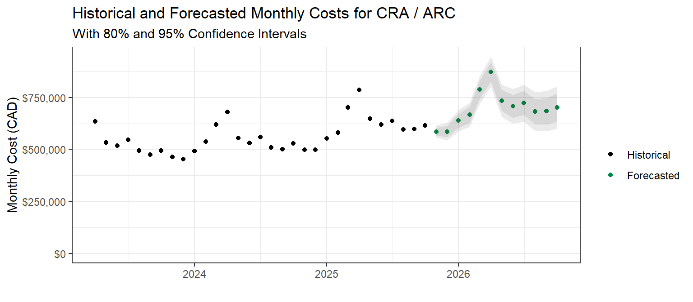
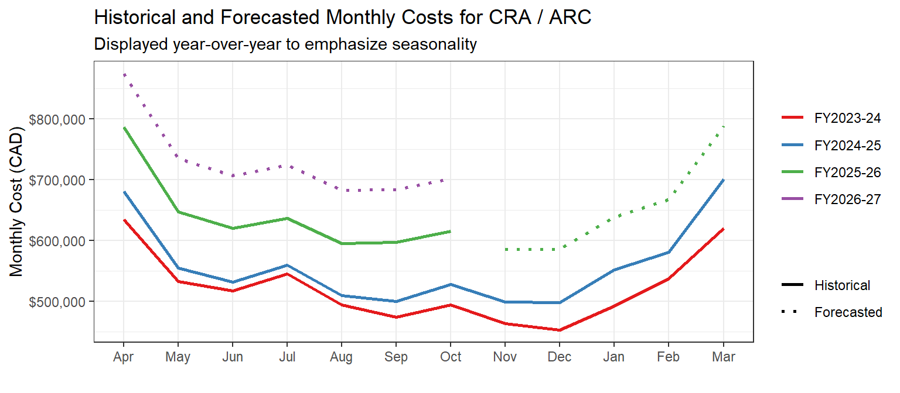

# ECM Partner Cost Forecasting

This repository contains scripts to clean and analyze data about historical
costs billed to External Credential Management partners. It uses those
historical costs to create forecasts of future costs, that can be compared
against MOU estimates to gauge whether a partner is at risk of exceeding their
budget.

# Data and Outputs
The cost data is not included in this repository. It is stored in a OneDrive
folder (in `data`), alongside the rendered results of the report (in `output`).
You can access that OneDrive folder [here](https://014gc-my.sharepoint.com/:f:/g/personal/colin_douglas_servicecanada_gc_ca/IgAdlnyr0nDfQ6EfL6r2CPDPAQsRlv5uFsSgcaixjPDHZ7o?e=TwddIb),
under the same project slug as this repository. (ESDC devices only)

## Analysis Examples

*Note: These are _examples_ of the analysis in this repository. For full analysis, look in the Sharepoint folder mentioned above.*

### Cost Forecasts

### Year-over-year Comparisons

 
